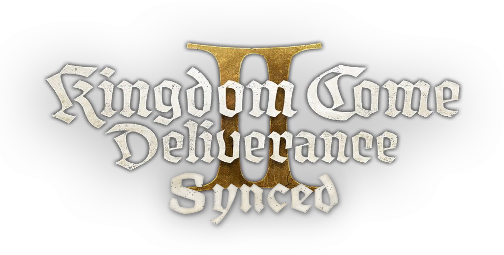

  

<h1 align="center">KCD2 Multiplayer Mod for Kingdom Come: Deliverance II</h1>

  <b>KCDS (Kingdom Come: Deliverance II Synced)</b> is a free multiplayer mod for KCD2. 
  Join a server with your friends, or host your own and make its rules.

  
  
  

> [!NOTE]
> **KCDS is in closed beta.** To get in, join our [Discord](https://discord.gg/Wte4rRJnSP).

## What KCDS adds

| | |
|---|---|
| 🌍 **One shared world** | Many players in the same open world: movement, animations, combat, riding and equipment, in sync. |
| 🗡️ **The game's own systems** | Inventory, skills and perks, crafting, alchemy and smithing, shops and trade, dice, horses and dogs. |
| 🎙️ **Voice chat** | Built in, with positional sound. |
| 🖥️ **Your own server** | Dedicated servers on Linux or Docker, a server browser in the game, whitelist, join queue and admin page. |
| 🧩 **Your own gamemodes** | Server and client scripts in JavaScript or TypeScript with the KCDS SDK. |
| 🏗️ **World Architect** | An in-game level editor whose work your server can load. |

## Get started

| | |
|---|---|
| 🎮 **Players** | [Player guide](https://kcdsynced.com/guides/player) · [KCD2 multiplayer with KCDS](https://kcdsynced.com/guides/kcd2-multiplayer) |
| 🖥️ **Server owners** | [Host a KCD2 server](https://kcdsynced.com/guides/server-owner) · [Server list](https://kcdsynced.com/servers) |
| 🛠️ **Developers** | [Developer guide](https://kcdsynced.com/guides/developer) · [Documentation](https://kcdsynced.com/docs) · [API reference](https://kcdsynced.com/docs/api) |
| ❓ **Questions** | [FAQ](https://kcdsynced.com/faq) · [Discord](https://discord.gg/Wte4rRJnSP) |

## Repositories

- [**KCDS-DOCS**](https://github.com/KCD-Synced/KCDS-DOCS): the documentation for players, server owners and resource
  authors. Found a mistake? Pull requests are welcome.

## FAQ

**Does Kingdom Come: Deliverance II have multiplayer?**
Not by itself: KCD2 is a singleplayer game. KCDS adds multiplayer, with dedicated servers anyone can run.

**Can we play the game's story together?**
No. You play together in a shared open world, and what happens there is up to the server: its rules, its scripts and
its own quests.

**Is KCDS free?**
Yes: the client, the server and the SDK.

**What do I need?**
Your own original copy of Kingdom Come: Deliverance II (game version 1.5.5) on Steam, and Windows 10 or 11 (64-bit).
KCDS checks that your copy is original and ships no game files.

---

Also searched as: KCD multiplayer · KCD 2 multiplayer · KCD2 MP · Kingdom Come Deliverance 2 multiplayer mod ·
KCD2 online · KCD2 dedicated server · KCD2 server.

KCDS is a community project, not affiliated with Warhorse Studios or Deep Silver / PLAION. Requires a licensed copy
of Kingdom Come: Deliverance II. KCDS ships no game files.
